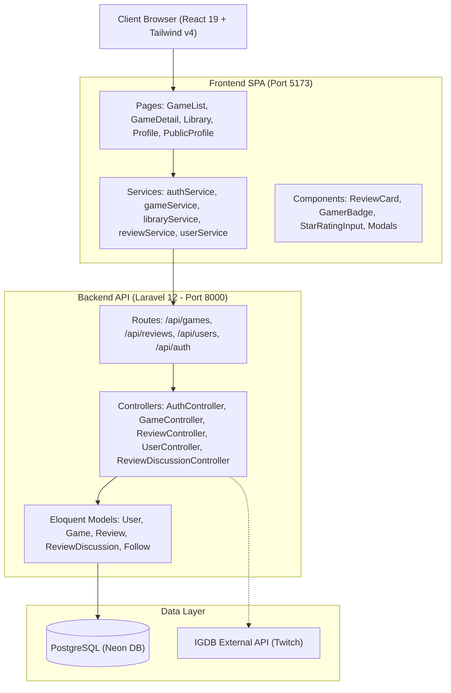

# 🎮 CritiPlay — Game Discovery, Backlog Tracker & Social Review Platform

<p align="center">
  
</p>

<p align="center">
  <strong>Platform penemuan game modern, pelacak backlog, ulasan multi-aspek, dan jejaring sosial gamer.</strong>
  <br />
  <em>Track your backlog, review games across multiple dimensions, showcase your Hall of Fame, and climb the gamer level ranks!</em>
</p>

<p align="center">
  
  
  
  
  
  
  
</p>

---

## 📌 Daftar Isi (Table of Contents)
- [Tentang CritiPlay](#-tentang-critiplay)
- [Fitur Utama](#-fitur-utama)
  - [1. Game Discovery & Koleksi Library](#1-game-discovery--koleksi-library)
  - [2. Multi-Aspect Review & Diskusi Komunitas](#2-multi-aspect-review--diskusi-komunitas)
  - [3. Hall of Fame (Showcase Game Favorit)](#3-hall-of-fame-showcase-game-favorit)
  - [4. Gamer Level & Badge Progression System](#4-gamer-level--badge-progression-system)
  - [5. Jejaring Sosial & Pencarian Pengguna](#5-jejaring-sosial--pencarian-pengguna)
  - [6. Autentikasi & Keamanan](#6-autentikasi--keamanan)
- [Tech Stack](#-tech-stack)
- [Arsitektur Proyek](#-arsitektur-proyek)
- [Panduan Instalasi & Menjalankan Lokal](#-panduan-instalasi--menjalankan-lokal)
  - [Prasyarat](#prasyarat)
  - [1. Setup Backend (Laravel)](#1-setup-backend-laravel)
  - [2. Setup Frontend (React + Vite)](#2-setup-frontend-react--vite)
- [Struktur Direktori](#-struktur-direktori)
- [Dokumentasi API](#-dokumentasi-api)
- [Lisensi](#-lisensi)

---

## 📖 Tentang CritiPlay

**CritiPlay** adalah web application modern yang didesain khusus bagi para gamer untuk mencatat, mengulas, dan membagikan pengalaman bermain mereka. Terinspirasi dari platform kurasi karya seperti *Letterboxd* dan *Backloggd*, CritiPlay menghadirkan estetika premium bernuansa gelap (*sleek obsidian dark mode*), gamifikasi level progresi nyata, serta sistem ulasan multi-dimensi.

---

## ✨ Fitur Utama

### 1. Game Discovery & Koleksi Library
- **Database Game Luas**: Terintegrasi langsung dengan katalog game melalui IGDB API dengan cover beresolusi tinggi, tahun rilis, genre, platform, serta ringkasan cerita.
- **Pelacak Status Backlog**: Kelola koleksi ke dalam 4 kategori status:
  - 🟢 **Completed**: Game yang telah tamat diselesaikan.
  - 🟣 **Playing**: Game yang saat ini sedang aktif dimainkan.
  - 🟡 **Plan to Play**: Daftar antrean game impian (*backlog*).
  - 🔴 **Dropped**: Game yang dihentikan permainannya.
- **Visualisasi Donut Chart**: Ringkasan persentase komposisi library interaktif di halaman profil.
- **Filter & Pengurutan Fleksibel**: Cari judul secara instan, urutkan berdasarkan abjad, tahun rilis, rating komunitas, maupun rating pribadi.
- **Tampilan Responsif Desktop & Mobile**: Dilengkapi tata letak kartu adaptif yang nyaman digunakan baik di layar ponsel maupun desktop.

---

### 2. Multi-Aspect Review & Diskusi Komunitas
- **Penilaian 4 Dimensi**: Berikan ulasan mendalam dengan skor 1.0 – 10.0 pada empat aspek utama:
  - 🎯 **Gameplay** (Mekanik & kendali permainan)
  - 📜 **Story** (Alur cerita & penokohan)
  - 🎨 **Visual** (Grafis, art style, & atmosfer)
  - ⭐ **Overall Score** (Penilaian menyeluruh)
- **Helpful Voting**: Komunitas dapat memberikan suara *Helpful* (Suka) pada ulasan berkualitas.
- **Diskusi Interaktif Berantai**: Pengguna dapat bertukar pikiran langsung di kolom komentar diskusi pada setiap ulasan game.

---

### 3. Hall of Fame (Showcase Game Favorit)
- **Rak Trophy 4-Slot Eksklusif**: Pamerkan hingga 4 game terbaik yang mendefinisikan selera bermainmu di profil pribadi dan profil publik.
  - 👑 **Slot #1 Top Pick**: Mendapatkan lencana emas metalik dengan ikon mahkota (*Crown*).
  - 🏆 **Slot #2 – #4**: Lencana peringkat dengan aksen perak dan amber.
- **Penyimpanan Permanen di Database**: Disimpan langsung ke kolom `showcase_game_ids` (JSONB PostgreSQL) sehingga dapat dilihat oleh publik di perangkat mana pun.
- **Curation Deck Modal**: Dilengkapi fitur pencarian library *real-time* dan pratinjau 4 slot langsung untuk kemudahan bongkar-pasang game favorit.
- **Tampilan Seimbang**: Slot kosong ditampilkan sebagai pedestal minimalis di profil publik atau tombol interaktif `+ Isi Slot` di profil pribadi.

---

### 4. Gamer Level & Badge Progression System
Sistem level dinamis yang terhitung otomatis di server berdasarkan keaktifan gamer:

#### Sumber Perolehan XP:
| Aktivitas | Perolehan XP |
| :--- | :--- |
| 📝 **Menulis Review Game** | `+50 XP` |
| 🏆 **Menyelesaikan Game (Completed)** | `+30 XP` |
| 🎮 **Memainkan Game (Playing)** | `+10 XP` |
| 📌 **Menambah Backlog (Plan to Play)** | `+5 XP` |
| 🌟 **Menerima Vote "Helpful" pada Review** | `+15 XP` |
| 💬 **Berkomentar di Diskusi** | `+5 XP` |

#### Tingkatan Tier & Pengaruhnya di Komunitas:
Tingkatan badge mempengaruhi tampilan pengguna di kolom komentar diskusi dan kartu review:

| Tier | Rentang Level | Badge Title | Efek Visual pada Pengguna |
| :--- | :--- | :--- | :--- |
| **Bronze** | Lv 1 – 4 | *Novice Explorer* | Ring avatar standar, teks nama putih bersih |
| **Silver** | Lv 5 – 9 | *Active Backlogger* | Ring avatar cyan, teks nama aksen sky |
| **Gold** | Lv 10 – 19 | *Hardcore Critic* | Ring avatar emas, teks nama aksen emas bersinar (`drop-shadow`) |
| **Platinum** | Lv 20 – 34 | *Master Completionist* | Ring avatar emerald, teks nama aksen hijau emerald bersinar |
| **Mythic** | Lv 35+ | *Mythic Legend* | Ring avatar neon pulse, **teks nama gradasi animasi shimmer**, bubble border khusus |

*Setiap profil dilengkapi **Interactive XP Progress Bar** yang menampilkan total XP, persentase progress, dan sisa XP menuju level berikutnya.*

---

### 5. Jejaring Sosial & Pencarian Pengguna
- **Follow & Unfollow System**: Bangun lingkaran pertemanan sesama gamer dan pantau koleksi mereka.
- **Pencarian User Case-Insensitive**: Cari pengguna secara cerdas tanpa terhambat perbedaan huruf besar dan kecil (misal: mencari `"sakti"` tetap menemukan `"Sakti"`).
- **Public Profile Page**: Lihat statistik library, aktivitas terbaru, ulasan, pengikut, dan showcase Hall of Fame milik gamer lain.

---

### 6. Autentikasi & Keamanan
- **Token-based Authentication**: Didukung oleh Laravel Sanctum.
- **Google OAuth Login**: Masuk instan dengan akun Google melalui Laravel Socialite.
- **Verifikasi Email OTP**: Pengamanan akun dengan kode OTP via email SMTP.
- **Kustomisasi Profil**: Pembaruan biodata serta unggah foto avatar kustom.

---

## 🛠️ Tech Stack

### Frontend
- **Framework**: [React 19](https://react.dev/) + [Vite 8](https://vitejs.dev/)
- **Bahasa**: [TypeScript](https://www.typescriptlang.org/)
- **Styling**: [Tailwind CSS v4](https://tailwindcss.com/)
- **Routing**: [React Router v7](https://reactrouter.com/)
- **Icons**: [Lucide React](https://lucide.dev/)

### Backend
- **Framework**: [Laravel 12 / 11](https://laravel.com/)
- **Runtime**: [PHP 8.3+](https://www.php.net/)
- **Database**: [PostgreSQL](https://www.postgresql.org/) (Serverless Cloud Neon DB)
- **Autentikasi**: Laravel Sanctum & Laravel Socialite (Google OAuth)
- **Dokumentasi API**: Scramble & Scalar OpenAPI Reference

---

## 📐 Arsitektur Proyek



---

## 🚀 Panduan Instalasi & Menjalankan Lokal

### Prasyarat
Pastikan komputer kamu telah terpasang:
- **Node.js** (v18 atau lebih baru) & **npm**
- **PHP** (v8.3 atau lebih baru) dengan ekstensi `pdo_pgsql`, `pgsql`, `curl`, `mbstring` aktif
- **Composer** (v2.x)
- Database **PostgreSQL** lokal atau akun cloud (misal [Neon.tech](https://neon.tech/))

---

### 1. Setup Backend (Laravel)

1. Masuk ke direktori Backend:
   ```bash
   cd Backend
   ```
2. Salin berkas environment konfigurasi:
   ```bash
   cp .env.example .env
   ```
3. Pasang dependensi PHP:
   ```bash
   composer install
   ```
4. Generate application key:
   ```bash
   php artisan key:generate
   ```
5. Sesuaikan konfigurasi database di `.env`:
   ```env
   DB_CONNECTION=pgsql
   DB_HOST=127.0.0.1
   DB_PORT=5432
   DB_DATABASE=critiplay
   DB_USERNAME=postgres
   DB_PASSWORD=your_password
   ```
6. Jalankan migrasi database:
   ```bash
   php artisan migrate
   ```
7. Buat symbolic link untuk penyimpanan upload avatar:
   ```bash
   php artisan storage:link
   ```
8. Jalankan server lokal:
   ```bash
   php artisan serve
   ```
   *Backend API aktif di `http://127.0.0.1:8000`*

---

### 2. Setup Frontend (React + Vite)

1. Buka terminal baru dan masuk ke direktori Frontend:
   ```bash
   cd Frontend
   ```
2. Pasang dependensi Node.js:
   ```bash
   npm install
   ```
3. Sesuaikan URL API pada konfigurasi jika diperlukan (`src/config/api.ts`).
4. Jalankan development server:
   ```bash
   npm run dev
   ```
5. Buka peramban di `http://localhost:5173`.

---

## 📁 Struktur Direktori

```
CritiPlay/
├── Backend/                    # Laravel 12 Backend API
│   ├── app/
│   │   ├── Http/Controllers/  # Auth, User, Game, Review, Discussion Controllers
│   │   └── Models/            # User, Game, Review, Follow, Discussion Models
│   ├── config/                # Database, Auth, Services config
│   ├── database/
│   │   └── migrations/        # PostgreSQL schema migrations
│   └── routes/
│       └── api.php            # RESTful API Endpoints
│
├── Frontend/                   # React 19 + TypeScript + Vite SPA
│   ├── src/
│   │   ├── components/        # Navbar, Footer, ReviewCard, GamerBadge, Modals
│   │   ├── pages/             # Home, GameDetail, Library, Profile, PublicProfile, Auth
│   │   ├── services/          # Fetch API wrappers (auth, game, library, review, user)
│   │   ├── types/             # TypeScript interfaces (GamerStats, Review, Game, etc.)
│   │   ├── config/            # API URLs and Storage endpoints
│   │   ├── App.tsx            # Routes configuration
│   │   └── index.css          # Tailwind CSS v4 design tokens
│   ├── package.json
│   └── vite.config.ts
│
└── README.md                   # Dokumentasi Utama Proyek
```

---

## 📡 Dokumentasi API

CritiPlay menyediakan dokumentasi OpenAPI interaktif yang dapat diakses melalui:
- **Scalar API Reference**: `http://127.0.0.1:8000/scalar`
- **Scramble OpenAPI JSON**: `http://127.0.0.1:8000/docs/api.json`

Beberapa endpoint utama:
- `POST /api/login` & `POST /api/register` — Autentikasi Pengguna
- `GET /api/profile` — Data Profil & Statistik Level Pengguna Login
- `GET /api/users/{id}/profile` — Profil Publik Pengguna & Showcase
- `PUT /api/users/showcase` — Update 4 Game Favorit (Hall of Fame)
- `GET /api/games` & `GET /api/games/{id}` — Katalog & Detail Game
- `GET /api/library` & `POST /api/library` — Manajemen Koleksi & Status Backlog
- `GET /api/games/{id}/reviews` — Daftar Ulasan Game dengan Badge Reviewer
- `GET /api/reviews/{id}/discussions` — Komentar Diskusi Ulasan

---

## 📄 Lisensi

Proyek ini dikembangkan di bawah lisensi [MIT License](https://opensource.org/licenses/MIT).

---

<p align="center">
  Dibuat dengan ❤️ untuk komunitas gamer oleh <strong><a href="https://github.com/SaktiArifDwiPutra">Sakti Arif Dwi Putra</a></strong>
</p>
